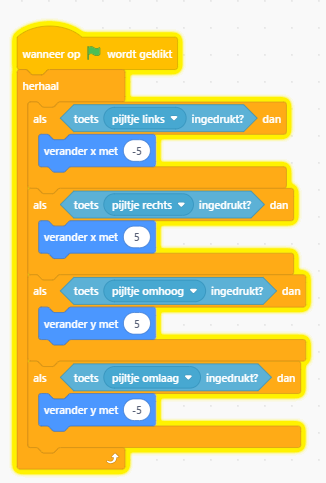
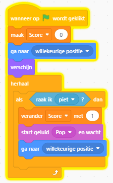
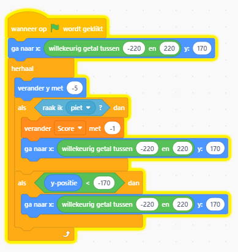
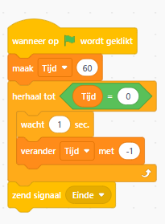
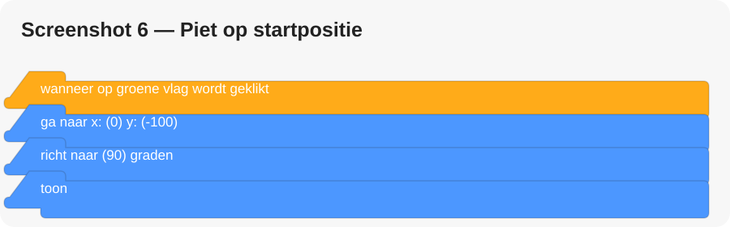

# 🎁 CoderDojo Scratch: Help Piet de cadeautjes bezorgen!

## Het verhaal

Het is bijna pakjesavond! Piet moet zo veel mogelijk cadeautjes verzamelen. Help Piet door een spel te programmeren waarin hij kan bewegen, cadeautjes oppakt en vallende sneeuwballen ontwijkt.

## 1. Start een nieuw Scratch-project (10 minuten)

1. Open [Scratch](https://scratch.mit.edu/).
2. Klik op **Maak**.
3. Verwijder de kat als je die niet wilt gebruiken.
4. Download de achtergrond en de sprites:

| sprite | Download |
|---|---|
| Achtergrond | [Download PNG](sprites/achtergrond.png) |
| Piet | [Download PNG](sprites/piet.png) |
| Cadeau | [Download PNG](sprites/cadeau.png) |
| Sneeuwbal | [Download PNG](sprites/sneeuwbal.png) |

5. Voeg een achtergrond toe, kies `Upload achtergrond` om onze eigen achtergrond te gebruiken

6. Voeg drie sprites toe, kies `Upload sprite` om onze eigen sprite te gebruiken :
   - **Piet** (de speler);
   - **Cadeautje**;
   - **Sneeuwbal** (het obstakel).

## 2. Laat Piet bewegen (20 minuten)

Klik op de sprite **Piet**. We gaan Piet met de pijltjestoetsen besturen.

### Blokken zoeken

- **Gebeurtenissen:** `wanneer op groene vlag wordt geklikt`
- **Besturen:** `herhaal voortdurend`, `als ... dan`
- **Waarnemen:** `toets ... ingedrukt?`
- **Beweging:** `verander x met ...`, `verander y met ...`

Bouw de blokken zoals hieronder. De vier toetsen krijgen elk hun eigen `als ... dan`-blok binnen `herhaal voortdurend`.


**Test:** klik op de groene vlag. Kan Piet alle kanten op bewegen?

**Probleemoplossing:**
- Beweegt Piet niet? Controleer of de scripts bij de sprite Piet staan.
- Beweegt Piet te snel? Verander `5` in `3`.
- Beweegt Piet de verkeerde kant op? Controleer de plus- en mintekens.

## 3. Cadeautjes verzamelen en punten verdienen (15 minuten)

Klik op de sprite **Cadeautje**.

### Maak een scorevariabele

1. Klik op **Variabelen**.
2. Klik op **Maak een variabele**.
3. Noem de variabele `Score`.
4. Kies **Voor alle sprites**.
5. Zet het vinkje bij `Score` aan, zodat de score op het speelveld zichtbaar is.

### Script voor het cadeautje



```text
wanneer op groene vlag wordt geklikt
maak [Score] [0]
ga naar willekeurige positie
verschijn
herhaal voortdurend
    als <raak ik [Piet]?> dan
        verander [Score] met (1)
        speel geluid [pop] tot einde
        ga naar willekeurige positie
```

**Let op:** maak de variabele `Score` maar één keer aan. In dit voorbeeld reset het cadeautje de score bij het starten van het spel.

**Test:** raakt Piet het cadeautje? Dan moet de score met 1 omhooggaan en moet het cadeautje naar een nieuwe plek springen.

**Extra tip:** als het cadeautje te vaak achter elkaar punten geeft, voeg dan na het aanraken heel kort `wacht (0.2) seconden` toe vóór het cadeautje naar een nieuwe positie gaat.

## 4. Voeg een vallende sneeuwbal toe (15 minuten)

Klik op de sprite **Sneeuwbal**. De sneeuwbal valt van boven naar beneden. Raakt hij Piet, dan verliest Piet een punt.



```text
wanneer op groene vlag wordt geklikt
ga naar x: (willekeurig) y: (170)
herhaal voortdurend
    verander y met (-5)
    als <raak ik [Piet]?> dan
        verander [Score] met (-1)
        ga naar x: (willekeurig) y: (170)
    als <(y-positie) < (-170)> dan
        ga naar x: (willekeurig) y: (170)
```

### Zo bouw je dit script

- Gebruik bij **Beweging** `verander y met (-5)`.
- Gebruik bij **Waarnemen** `raak ik [Piet]?`.
- Gebruik bij **Variabelen** `verander [Score] met (-1)`.
- Gebruik bij **Beweging** `ga naar x: ... y: ...`.
- Gebruik bij **Functies** van Beweging/Operators de willekeurige waarde voor de x-positie. In Scratch heet het blok `willekeurig getal tussen (1) en (10)`; stel de grenzen bijvoorbeeld in op `-220` en `220`.
- Gebruik bij **Waarnemen** de `y-positie`-waarde en bij **Operatoren** de `<`-vergelijking.

**Let op bij het bouwen:** vul bij `ga naar x: ... y: ...` als x-waarde een willekeurig getal tussen `-220` en `220` in, en als y-waarde `170`.

**Test:** valt de sneeuwbal omlaag? Verschijnt hij weer bovenaan als hij onder het scherm komt?

## 5. Voeg een timer toe (10 minuten)

Maak bij **Variabelen** een tweede variabele: `Tijd`. Kies ook hier **Voor alle sprites**.

Je kunt het timerscript op de achtergrond zetten, of op een aparte sprite met de naam `Spelbesturing`.



```text
wanneer op groene vlag wordt geklikt
maak [Tijd] [60]
herhaal totdat <(Tijd) = (0)>
    wacht (1) seconden
    verander [Tijd] met (-1)
zend signaal [Einde]
```

### Eindscherm tonen

Kies de sprite **Piet** of maak een aparte sprite met de tekst `Einde`. Gebruik dit script:



```text
wanneer ik signaal [Einde] ontvang
zeg [Tijd is om! Goed gedaan!] gedurende (3) sec.
stop [alle scripts]
```

**Test:** start het spel en kijk of de timer van 60 naar 0 telt. Als de tijd op is, moet het eindbericht verschijnen.

**Let op:** maak het signaal `Einde` aan via het keuzemenu van het blok `zend signaal`. Kies daarna hetzelfde signaal bij `wanneer ik signaal ... ontvang`.

## 6. Maak het spel persoonlijk (10 minuten)

### Makkelijke extra's
- Voeg een geluid toe als Piet een cadeau pakt.
- Verander de achtergrond.
- Geef Piet een andere startpositie.
- Laat Piet iets zeggen bij het begin.

### Uitdagendere extra's
- Maak een gouden cadeau dat 5 punten waard is.
- Laat twee sneeuwballen vallen.
- Maak de sneeuwbal steeds sneller.
- Voeg een tweede level toe.
- Laat het spel eindigen als de score 10 punten is.

### Startpositie van Piet

Zet dit bovenaan het bewegingsscript, direct na de groene vlag:



```text
wanneer op groene vlag wordt geklikt
ga naar x: (0) y: (-100)
richt naar (90) graden
toon
```

Als je dit toevoegt, plaats dan de overige bewegingsblokken onder dezelfde startgebeurtenis. Gebruik dus niet twee aparte groene-vlag-scripts die elkaar onbedoeld beïnvloeden.